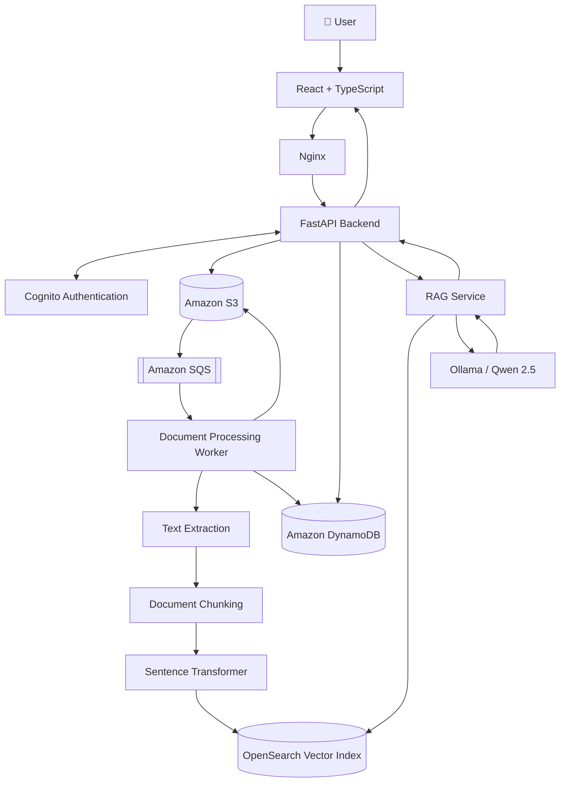
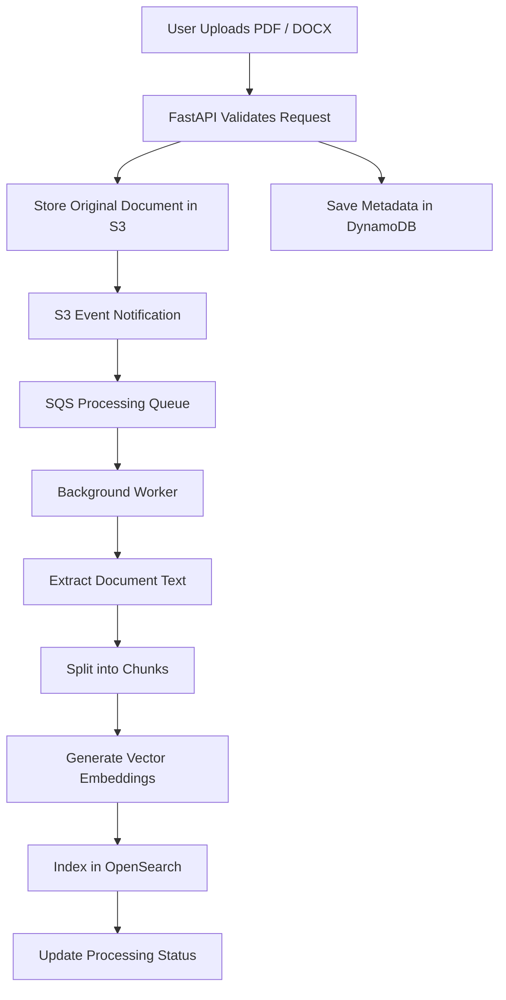
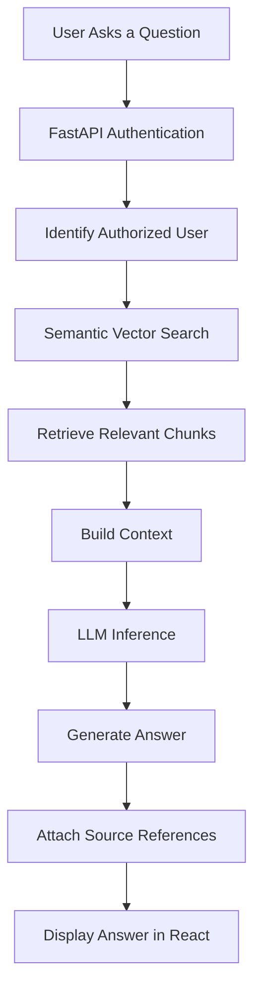

# 🧠 DocuMind AI
### Turn your documents into an intelligent, searchable knowledge base.

**Upload. Process. Retrieve. Understand.**

DocuMind AI is a cloud-native document intelligence platform that transforms static documents into a private, searchable knowledge base using **Retrieval-Augmented Generation (RAG)**.

Upload your PDFs and DOCX files, let the platform asynchronously process and index their contents, and interact with your documents through a conversational AI assistant that provides context-aware, source-backed answers.

Instead of searching through hundreds of pages manually, simply ask a question.

---

<p align="center">


</p>

<p align="center">
  
  
  
</p>

---

## ✨ The Problem

Traditional document management systems are good at storing files, but not necessarily at helping people understand them.

Consider having hundreds of PDFs containing technical documentation, research papers, reports, or business documents.

Finding a specific answer requires manually opening files, searching for keywords, and connecting information across multiple documents.

**DocuMind AI addresses this problem by combining:**

- Intelligent document ingestion.
- Asynchronous document processing.
- Semantic vector search.
- Large Language Model (LLM) inference.
- Retrieval-Augmented Generation.
- Source-backed conversational answers.

The result is a document intelligence platform where your knowledge becomes accessible through natural language.

## 🚀 Key Features

| Feature | Description |
|---|---|
| 🔐 Authentication | Cognito-compatible authentication with JWT verification |
| 📄 Document Upload | Upload PDF and DOCX documents through the web interface |
| ☁️ Object Storage | Store original documents using S3-compatible storage |
| ⚡ Async Processing | Process documents using an SQS-based background worker |
| 📝 Text Extraction | Extract content from PDF and DOCX files |
| ✂️ Intelligent Chunking | Divide extracted content into smaller, searchable passages |
| 🧬 Vector Embeddings | Generate 384-dimensional embeddings using Sentence Transformers |
| 🔎 Semantic Search | Retrieve relevant passages through OpenSearch |
| 🤖 AI Assistant | Ask natural-language questions using RAG |
| 📚 Source References | Display document names and page references alongside answers |
| 📊 Document Library | Track document uploads, processing status, and indexing statistics |
| 🐳 Containerized | Run frontend, backend, and worker using Docker Compose |

## 🏗️ System Architecture

DocuMind AI follows an event-driven, service-oriented architecture.

The application separates the user-facing API from resource-intensive document processing, allowing ingestion and question answering to operate independently.

### High-Level Architecture



**Architecture principle:** Document ingestion should not block user-facing API requests. Background processing handles extraction, chunking, embedding generation, and indexing independently.

### Architecture Components

| Layer | Responsibility | Technology |
|---|---|---|
| Presentation | User interface and document management | React, TypeScript |
| Reverse Proxy | Frontend hosting and API routing | Nginx |
| API Layer | Authentication, uploads, search, and chat | FastAPI |
| Identity | Authentication and token validation | Cognito-compatible service |
| Object Storage | Original and extracted documents | Amazon S3 |
| Messaging | Asynchronous processing events | Amazon SQS |
| Metadata | Document ownership and processing status | DynamoDB |
| Processing | Extraction, chunking, and embeddings | Python Worker |
| Vector Search | Semantic retrieval | OpenSearch |
| Embeddings | Text-to-vector conversion | Sentence Transformers |
| AI Inference | Contextual answer generation | Ollama / Qwen 2.5 |

**Local development:** AWS-compatible services are used through Floci. OpenSearch and Ollama are provisioned in the local environment.

**Production direction:** The architecture is designed around AWS services, with production deployment planned separately.

---

## 🔄 How It Works

DocuMind AI consists of two primary pipelines:

1. Document ingestion and indexing.
2. Retrieval-Augmented Generation and question answering.

### 1. Document Ingestion Pipeline

When a user uploads a document, the platform processes it asynchronously.



**Processing sequence:**

1. User authenticates through the Cognito-compatible authentication service.
2. Frontend sends the document to FastAPI.
3. Backend validates the document format, content, and file size.
4. Original document is stored in S3.
5. Document metadata and ownership information are recorded in DynamoDB.
6. An S3 object-created notification triggers an SQS message.
7. Background worker consumes the processing message.
8. Worker downloads and extracts document text.
9. Extracted content is divided into smaller chunks.
10. Sentence Transformers generates vector embeddings.
11. Document chunks and metadata are indexed in OpenSearch.
12. DynamoDB is updated with the final processing status and chunk count.

### 2. RAG Question-Answering Pipeline

Once documents are indexed, users can ask questions through the AI Assistant.



**Retrieval sequence:**

1. User submits a natural-language question.
2. FastAPI authenticates the request.
3. Backend identifies the authenticated user.
4. Retrieval service searches the user's authorized document collection.
5. OpenSearch returns the most relevant document chunks.
6. Retrieved context is supplied to the language model.
7. The LLM generates a contextual answer.
8. Backend returns the response, model information, and source references.
9. React displays the answer alongside document names and page references.

**Why RAG?**

Rather than relying exclusively on the LLM's pretrained knowledge, RAG grounds responses in the content retrieved from the user's documents.

---

## 🛠️ Technology Stack

This project combines modern application development, cloud infrastructure, distributed processing, and generative AI.

### Frontend

| Technology | Purpose |
|---|---|
| React 19 | Component-based UI |
| TypeScript 6 | Type-safe development |
| Vite | Development server and build tooling |
| Tailwind CSS | Responsive styling |
| Lucide React | Icons |

### Backend and AI

| Technology | Purpose |
|---|---|
| Python 3.12 | Backend and processing |
| FastAPI | REST API development |
| Pydantic | Request and configuration validation |
| Sentence Transformers | Vector embedding generation |
| all-MiniLM-L6-v2 | 384-dimensional embedding model |
| Ollama | Local LLM runtime |
| Qwen 2.5 0.5B Instruct | Local language model |
| OpenSearch | Vector indexing and retrieval |

### AWS and Infrastructure

| Technology | Purpose |
|---|---|
| Amazon Cognito | Authentication architecture |
| Amazon S3 | Object storage |
| Amazon SQS | Message queue |
| Amazon DynamoDB | Metadata storage |
| Floci | Local AWS-compatible services |
| Terraform | Infrastructure as Code |
| Docker | Containerization |
| Docker Compose | Local orchestration |
| Nginx | Reverse proxy and frontend hosting |

---

## 📁 Repository Structure

```text
documind-ai/
│
├── backend/
│   ├── app/
│   │   ├── api/
│   │   │   └── routes/
│   │   │       ├── chat.py
│   │   │       ├── documents.py
│   │   │       ├── health.py
│   │   │       ├── search.py
│   │   │       └── session.py
│   │   │
│   │   ├── core/
│   │   │   ├── auth.py
│   │   │   └── config.py
│   │   │
│   │   ├── schemas/
│   │   │
│   │   ├── services/
│   │   │   ├── chunking.py
│   │   │   ├── document_service.py
│   │   │   ├── embedding_service.py
│   │   │   ├── rag_service.py
│   │   │   ├── search_service.py
│   │   │   └── vector_store.py
│   │   │
│   │   └── workers/
│   │       └── document_worker.py
│   │
│   ├── tests/
│   ├── Dockerfile
│   └── requirements.txt
│
├── frontend/
│   ├── src/
│   │   ├── components/
│   │   │   └── LoginPage.tsx
│   │   ├── lib/
│   │   │   └── api.ts
│   │   ├── App.tsx
│   │   └── index.css
│   │
│   ├── Dockerfile
│   ├── nginx.conf
│   └── package.json
│
├── infrastructure/
│   └── local/
│       ├── eventing.tf
│       ├── main.tf
│       ├── opensearch.tf
│       ├── outputs.tf
│       ├── provider.tf
│       └── variables.tf
│
├── docker-compose.yml
├── .env.example
├── .gitignore
└── README.md
```

---

## ⚡ Getting Started

Follow these instructions to run the local Docker MVP.

### Prerequisites

Ensure the following tools and services are available:

| Requirement | Purpose |
|---|---|
| Docker Desktop | Container runtime |
| Docker Compose | Multi-container orchestration |
| Git | Source code management |
| Python 3.12 | Backend development |
| Node.js and npm | Frontend development |
| Ollama | Local LLM inference |
| Floci | Local AWS-compatible services |
| OpenSearch | Vector indexing and retrieval |

You will also need the local S3 bucket, SQS queues, DynamoDB table, and Cognito-compatible user pool configured.

### Step 1. Clone the repository

```bash
git clone https://github.com/AyaanShaheer/documind-ai.git

cd documind-ai
```

### Step 2. Configure environment variables

Create the backend environment file:

```bash
cp .env.example backend/.env
```

Update `backend/.env` with your local environment configuration.

Example configuration:

```env
# Application
APP_NAME=DocuMind AI
APP_ENV=local

# AWS-compatible configuration
AWS_REGION=us-east-1
AWS_ACCESS_KEY_ID=test
AWS_SECRET_ACCESS_KEY=test

FLOCI_ENDPOINT=http://localhost:4566

# Object Storage
S3_BUCKET_NAME=documind-documents

# Metadata
DYNAMODB_TABLE_NAME=documind-metadata

# Messaging
SQS_PROCESSING_QUEUE_NAME=documind-processing
SQS_DLQ_NAME=documind-processing-dlq

# Authentication
COGNITO_USER_POOL_ID=your-user-pool-id
COGNITO_APP_CLIENT_ID=your-app-client-id
COGNITO_ISSUER=http://localhost:4566/your-user-pool-id
COGNITO_JWKS_URL=http://localhost:4566/your-user-pool-id/.well-known/jwks.json

# Embeddings
EMBEDDING_MODEL=sentence-transformers/all-MiniLM-L6-v2
EMBEDDING_DIMENSION=384

# OpenSearch
OPENSEARCH_HOST=localhost
OPENSEARCH_PORT=9400
OPENSEARCH_INDEX_NAME=documind-chunks

# LLM
OLLAMA_BASE_URL=http://localhost:11434
OLLAMA_MODEL=qwen2.5:0.5b-instruct

# RAG
RAG_TOP_K=5
```

> These are example local configuration values. Replace identifiers and endpoints with those from your actual environment.

**Security:** Never commit `.env` files, credentials, API keys, access tokens, or other secrets to Git.

### Step 3. Prepare Ollama

Pull the configured model:

```bash
ollama pull qwen2.5:0.5b-instruct
```

Ensure Ollama is running and accessible on port `11434`.

### Step 4. Start the application

From the project root:

```bash
docker compose up --build -d
```

Check running containers:

```bash
docker compose ps
```

### Step 5. Inspect application logs

Backend:

```bash
docker compose logs -f backend
```

Document worker:

```bash
docker compose logs -f worker
```

Frontend:

```bash
docker compose logs -f frontend
```

### Step 6. Access the application

Once the required services are running:

| Service | URL |
|---|---|
| DocuMind AI Frontend | http://localhost:8080 |
| FastAPI Backend | http://localhost:8000 |
| Swagger API Documentation | http://localhost:8000/docs |
| Floci | http://localhost:4566 |
| OpenSearch | http://localhost:9400 |
| Ollama | http://localhost:11434 |

Sign in using a user configured in your local Cognito-compatible user pool.

---

## 🔧 Application Management

### Stop the application

```bash
docker compose stop
```

### Restart the application

```bash
docker compose up -d
```

### Remove containers and networks

```bash
docker compose down
```

This preserves named volumes.

**Warning:** Avoid `docker compose down -v` unless you intentionally want to delete persistent volumes and their data.

---

## 💻 Running in Development Mode

You can also run individual application components outside Docker.

### Backend API

```bash
cd backend

python3.12 -m venv .venv

source .venv/bin/activate

pip install -r requirements.txt

uvicorn app.main:app --reload --host 0.0.0.0 --port 8000
```

### Document Processing Worker

Open another terminal:

```bash
cd backend

source .venv/bin/activate

python -m app.workers.document_worker
```

### Frontend

Open another terminal:

```bash
cd frontend

npm install

npm run dev -- --host 0.0.0.0
```

Access the frontend:

```text
http://localhost:5173
```

The Vite development proxy forwards API requests to FastAPI on port `8000`.

---

## 🔌 API Reference

The backend exposes REST endpoints for authentication, document management, semantic search, and conversational AI.

### Available Endpoints

| Method | Endpoint | Authentication | Description |
|---|---|---|---|
| GET | `/api/v1/health` | Public | Application health check |
| POST | `/api/v1/auth/login` | Public | Authenticate user |
| POST | `/api/v1/documents/upload` | Required | Upload document |
| GET | `/api/v1/documents/` | Required | List user documents |
| POST | `/api/v1/search/` | Required | Search document chunks |
| POST | `/api/v1/chat/` | Required | Ask questions using RAG |

Protected endpoints require a valid access token:

```http
Authorization: Bearer <ACCESS_TOKEN>
```

### Authentication

```bash
curl -X POST http://localhost:8000/api/v1/auth/login \
  -H "Content-Type: application/json" \
  -d '{
    "username": "YOUR_USERNAME",
    "password": "YOUR_PASSWORD"
  }'
```

### Upload a Document

```bash
curl -X POST http://localhost:8000/api/v1/documents/upload \
  -H "Authorization: Bearer $ACCESS_TOKEN" \
  -F "file=@./example.pdf"
```

### List Documents

```bash
curl http://localhost:8000/api/v1/documents/ \
  -H "Authorization: Bearer $ACCESS_TOKEN"
```

### Semantic Search

```bash
curl -X POST http://localhost:8000/api/v1/search/ \
  -H "Authorization: Bearer $ACCESS_TOKEN" \
  -H "Content-Type: application/json" \
  -d '{
    "question": "What are the main infrastructure requirements?",
    "top_k": 5
  }'
```

### Chat with Your Documents

```bash
curl -X POST http://localhost:8000/api/v1/chat/ \
  -H "Authorization: Bearer $ACCESS_TOKEN" \
  -H "Content-Type: application/json" \
  -d '{
    "question": "Summarize the key points in my documents.",
    "top_k": 5
  }'
```

---

## 🗄️ Data Storage Design

DocuMind AI separates document storage, metadata management, and vector indexing.

### 1. DynamoDB Metadata

Document metadata uses a composite primary key.

| Attribute | Key Type |
|---|---|
| `user_id` | Partition Key |
| `document_id` | Sort Key |

Stored metadata includes:

- Filename.
- Content type.
- File size in bytes.
- Processing status.
- S3 bucket and object key.
- Creation and update timestamps.
- Number of generated chunks.
- Processing error information, when applicable.

### 2. S3 Object Structure

Original uploaded documents:

```text
incoming/
└── {user_id}/
    └── {document_id}/
        └── {filename}
```

Extracted document text:

```text
processed/
└── {user_id}/
    └── {document_id}/
        └── extracted.txt
```

### 3. OpenSearch Vector Index

Index:

```text
documind-chunks
```

Embedding configuration:

| Parameter | Value |
|---|---|
| Embedding Model | all-MiniLM-L6-v2 |
| Vector Dimensions | 384 |
| Vector Database | OpenSearch |
| Retrieval Strategy | Semantic Vector Search |

---

## 🔐 Security and Multi-Tenancy

Security is an important part of the application architecture.

DocuMind AI implements user-scoped access controls to ensure that document operations are associated with the authenticated user.

### Authentication and Authorization

- JWT authentication using Cognito-compatible access tokens.
- RS256 signature verification.
- JWT issuer and token-claim validation.
- User identity derived from the verified token subject (`sub`).
- User-scoped document access and retrieval.
- Authorization does not rely on browser-supplied user IDs.

### Document Security

- File extension validation.
- Content-type validation.
- Document structure validation.
- File size validation.
- Original document storage in S3-compatible object storage.
- Environment files and local infrastructure state excluded from Git.

### Production Security Considerations

The current frontend stores the access token in browser `sessionStorage`.

For production, a hardened session architecture, such as a Backend-for-Frontend (BFF) with secure, HTTP-only cookies, should be evaluated.

Additional production controls include:

- IAM roles and least-privilege permissions.
- AWS Secrets Manager for sensitive configuration.
- HTTPS and TLS termination.
- Private networking for internal services.
- Restricted access to OpenSearch and administrative endpoints.
- Production logging, monitoring, and alerting.

Floci, OpenSearch, Ollama, and administrative services should not be exposed directly to the public internet.

---

## 📊 Project Status

<details>
<summary><strong>Implemented — Local Docker MVP</strong></summary>

- [✅] React + TypeScript frontend.
- [✅] Cognito-compatible authentication.
- [✅] JWT-protected API routes.
- [✅] Multi-tenant document access.
- [✅] PDF and DOCX document uploads.
- [✅] S3-compatible document storage.
- [✅] SQS-based asynchronous processing.
- [✅] Document extraction and chunking.
- [✅] Sentence Transformer embeddings.
- [✅] OpenSearch vector indexing.
- [✅] DynamoDB metadata management.
- [✅] RAG-powered question answering.
- [✅] Retrieved source references.
- [✅] Dockerized frontend, backend, and worker.

</details>

<details>
<summary><strong>Planned — AWS Production Deployment</strong></summary>

- [ ] Production Terraform configuration.
- [ ] Amazon ECR image publishing.
- [ ] Amazon ECS Fargate deployment.
- [ ] Production Amazon Cognito configuration.
- [ ] Amazon S3 and SQS production resources.
- [ ] DynamoDB production table configuration.
- [ ] Amazon OpenSearch deployment.
- [ ] Amazon Bedrock integration.
- [ ] Application Load Balancer.
- [ ] Amazon CloudFront.
- [ ] HTTPS and custom domain.
- [ ] IAM least-privilege roles.
- [ ] AWS Secrets Manager integration.
- [ ] GitHub Actions CI/CD.
- [ ] Prometheus/Grafana or AWS-native monitoring.
- [ ] Production logging, alerting, backup, and recovery.

</details>

---

## 🗺️ Future Enhancements

Potential improvements for subsequent iterations:

| Area | Planned Enhancement |
|---|---|
| Document Support | Additional document formats |
| Retrieval | Hybrid search and reranking |
| AI Quality | Improved citation validation |
| Collaboration | Document-level permissions and sharing |
| Conversations | Persistent chat history and sessions |
| User Experience | Document previews and downloads |
| Analytics | User-level usage analytics |
| Lifecycle | Document deletion and lifecycle management |
| Observability | Production-grade monitoring and cost controls |

---

## 🧯 Troubleshooting

### Frontend Loads but API Requests Fail

- Check backend container health.
- Inspect `docker compose logs -f backend`.
- Verify Nginx proxies `/api/` to `backend:8000`.
- Access the application through `http://localhost:8080`.

### Cognito Login Fails

- Confirm Floci is running.
- Verify the user pool ID and application client ID.
- Check issuer and JWKS configuration.
- Verify the app client supports `USER_PASSWORD_AUTH`.
- Inspect backend logs without exposing credentials.

### Documents Remain in Processing

- Inspect worker logs.
- Verify S3 bucket notifications.
- Verify the SQS processing queue.
- Check DynamoDB document status.
- Confirm OpenSearch connectivity.

### OpenSearch Connectivity Fails

The Docker Compose configuration expects the local OpenSearch service to be accessible from containers through:

```text
host.docker.internal:9400
```

Confirm that OpenSearch is running and reachable.

### AI Assistant Returns Poor Answers

- Verify that the document has been indexed.
- Check whether extracted text is correct.
- Review retrieved source passages.
- Verify Ollama is running.
- Confirm that the configured model is available.

---

## 🤝 Contributing

Contributions, suggestions, and issue reports are welcome.

To contribute:

1. Fork the repository.
2. Create a feature branch.
3. Implement your changes.
4. Add or update tests where appropriate.
5. Submit a pull request explaining your changes.

Please do not commit:

- `.env` files.
- Credentials or API keys.
- Terraform state files.
- Local model caches.
- Generated runtime data.

---

## 📜 License

No license has been added yet.

Until a license is included, the project remains subject to default copyright rules. Do not assume that it is freely reusable.

---

## 👨‍💻 Author

**Ayaan Shaheer**

Software Engineer | MLOps | GenAI Infrastructure | Cloud-Native Systems

Building systems at the intersection of AI engineering, cloud infrastructure, and platform engineering.

<p align="left">
  <a href="https://github.com/AyaanShaheer">
    
  </a>
</p>

---

<p align="center">

### 🧠 DocuMind AI

**From document storage to source-grounded intelligence.**

*Built with Python, React, AWS architecture, and Generative AI.*

</p>
