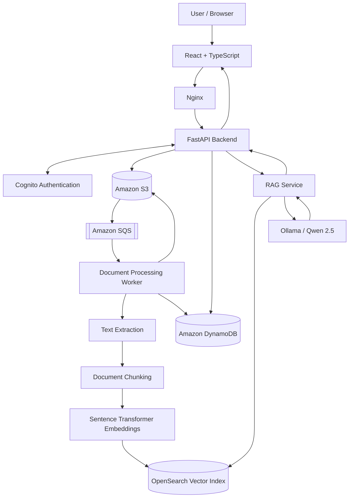

# DocuMind AI

<p align="center">
  **Turn your documents into a private, searchable knowledge base.**
  
  Upload documents, retrieve relevant passages, and ask questions in natural language with source-backed AI answers.
</p>

<p align="center">
  
  
  
  
  
  
</p>

---

## Overview

**DocuMind AI** is a cloud-native document intelligence and Retrieval-Augmented Generation (RAG) platform designed to transform static documents into an interactive knowledge base.

Users can securely upload documents, process them asynchronously, generate vector embeddings, and interact with their knowledge base through a conversational AI interface.

Instead of manually searching through hundreds of pages, users can ask natural-language questions and receive contextual answers grounded in retrieved document content, with source references.

The application combines document ingestion, asynchronous processing, vector search, and LLM-powered question answering in one workspace.

**Current status:** Working local Docker MVP. Public AWS production deployment is planned but has not yet been completed.

## Key Features

- **Secure Authentication:** Cognito-compatible authentication with JWT verification and user-scoped API access.
- **Document Upload:** Upload PDF and DOCX documents through a React-based interface.
- **Cloud Object Storage:** Store original documents in Amazon S3-compatible storage.
- **Asynchronous Processing:** SQS-based background processing using a dedicated Python worker.
- **Document Extraction:** Extract text from PDF and DOCX documents.
- **Intelligent Chunking:** Split extracted text into model-sized chunks while retaining document and page references.
- **Vector Embeddings:** Generate 384-dimensional embeddings using Sentence Transformers.
- **Semantic Search:** Retrieve relevant document chunks using OpenSearch vector search.
- **RAG-powered Chat:** Ask questions about uploaded documents using a local LLM.
- **Source-backed Answers:** Display retrieved document names and page references alongside AI responses.
- **Live Document Library:** View uploaded documents, processing statuses, and indexing statistics.
- **Dockerized Deployment:** Run the frontend, backend, and worker as containerized services.

## Architecture



The architecture uses AWS-compatible services locally through Floci. The production AWS architecture is planned.

## Document Processing Workflow

1. **Authentication:** The user signs in through the Cognito-compatible authentication service.
2. **Upload:** The frontend sends a document to FastAPI with a Cognito access token.
3. **Validation:** FastAPI validates document type, content, and file size.
4. **Storage:** The original document is stored in S3.
5. **Metadata:** Document ownership, metadata, and processing status are recorded in DynamoDB.
6. **Queueing:** An S3 object-created notification sends a message to SQS.
7. **Extraction:** The background worker downloads the document and extracts its text.
8. **Chunking:** Extracted text is divided into smaller chunks.
9. **Embedding:** Sentence Transformers generates vector embeddings.
10. **Indexing:** Document chunks and their metadata are indexed in OpenSearch.
11. **Status Update:** DynamoDB records the processing result and chunk count.

## RAG Question-Answering Workflow

1. The user enters a natural-language question in the AI Assistant.
2. FastAPI authenticates the request and identifies the user.
3. The retrieval service searches the user's authorized document collection.
4. Relevant chunks are retrieved from OpenSearch.
5. Retrieved context is supplied to the LLM.
6. The LLM generates a contextual response.
7. FastAPI returns the answer, model information, and retrieved sources.
8. The React frontend displays the response and source references.

## Technology Stack

| Component | Technology | Purpose |
|---|---|---|
| Frontend | React, TypeScript | User interface |
| Build Tool | Vite | Frontend development and production builds |
| Styling | Tailwind CSS | Responsive UI |
| Icons | Lucide React | UI icons |
| Backend | Python 3.12, FastAPI | REST API |
| Validation | Pydantic | Request and configuration validation |
| Authentication | Amazon Cognito, JWT, PyJWT | User authentication and authorization |
| Object Storage | Amazon S3 | Document storage |
| Messaging | Amazon SQS | Asynchronous processing |
| Metadata | Amazon DynamoDB | Document metadata and ownership |
| Vector Database | OpenSearch | Vector indexing and retrieval |
| Embedding Model | all-MiniLM-L6-v2 | 384-dimensional embeddings |
| LLM | Qwen 2.5 0.5B Instruct | Local AI inference |
| LLM Runtime | Ollama | Local model serving |
| AWS Emulation | Floci | Local AWS-compatible services |
| Containerization | Docker, Docker Compose | Application packaging |
| Web Server | Nginx | Frontend hosting and API reverse proxy |
| Infrastructure | Terraform | Infrastructure provisioning |

## Repository Structure

```text
documind-ai/
│
├── backend/
│   ├── app/
│   │   ├── api/
│   │   │   └── routes/
│   │   │       ├── chat.py
│   │   │       ├── documents.py
│   │   │       ├── health.py
│   │   │       ├── search.py
│   │   │       └── session.py
│   │   │
│   │   ├── core/
│   │   │   ├── auth.py
│   │   │   └── config.py
│   │   │
│   │   ├── schemas/
│   │   ├── services/
│   │   │   ├── chunking.py
│   │   │   ├── document_service.py
│   │   │   ├── embedding_service.py
│   │   │   ├── rag_service.py
│   │   │   ├── search_service.py
│   │   │   └── vector_store.py
│   │   │
│   │   └── workers/
│   │       └── document_worker.py
│   │
│   ├── tests/
│   ├── Dockerfile
│   └── requirements.txt
│
├── frontend/
│   ├── src/
│   │   ├── components/
│   │   │   └── LoginPage.tsx
│   │   ├── lib/
│   │   │   └── api.ts
│   │   ├── App.tsx
│   │   └── index.css
│   │
│   ├── Dockerfile
│   ├── nginx.conf
│   └── package.json
│
├── infrastructure/
│   └── local/
│       ├── eventing.tf
│       ├── main.tf
│       ├── opensearch.tf
│       ├── outputs.tf
│       ├── provider.tf
│       └── variables.tf
│
├── docker-compose.yml
├── .env.example
├── .gitignore
└── README.md
```

## Getting Started

### Prerequisites

- Docker Desktop with WSL 2 integration.
- Docker Compose.
- Git.
- Ollama installed on the host.
- A local Floci environment.
- OpenSearch provisioned and accessible.
- Local S3 bucket, SQS queues, DynamoDB table, and Cognito-compatible user pool configured.

### 1. Clone the repository

```bash
git clone https://github.com/AyaanShaheer/documind-ai.git

cd documind-ai
```

### 2. Configure environment variables

Create the backend environment file:

```bash
cp .env.example backend/.env
```

Update `backend/.env` with your local configuration.

Important variables include:

```env
APP_NAME=DocuMind AI
APP_ENV=local

AWS_REGION=us-east-1
AWS_ACCESS_KEY_ID=test
AWS_SECRET_ACCESS_KEY=test

FLOCI_ENDPOINT=http://localhost:4566

S3_BUCKET_NAME=documind-documents
DYNAMODB_TABLE_NAME=documind-metadata

SQS_PROCESSING_QUEUE_NAME=documind-processing
SQS_DLQ_NAME=documind-processing-dlq

COGNITO_USER_POOL_ID=your-user-pool-id
COGNITO_APP_CLIENT_ID=your-app-client-id
COGNITO_ISSUER=http://localhost:4566/your-user-pool-id
COGNITO_JWKS_URL=http://localhost:4566/your-user-pool-id/.well-known/jwks.json

EMBEDDING_MODEL=sentence-transformers/all-MiniLM-L6-v2
EMBEDDING_DIMENSION=384

OPENSEARCH_HOST=localhost
OPENSEARCH_PORT=9400
OPENSEARCH_INDEX_NAME=documind-chunks

OLLAMA_BASE_URL=http://localhost:11434
OLLAMA_MODEL=qwen2.5:0.5b-instruct

RAG_TOP_K=5
```

These values are examples for the local environment. Use the actual IDs and configuration from your local setup.

**Never commit `.env` files, passwords, API keys, access tokens, or other secrets.**

### 3. Prepare Ollama

Pull the configured local model:

```bash
ollama pull qwen2.5:0.5b-instruct
```

Ensure Ollama is running and accessible on port `11434`.

### 4. Start the application

From the project root:

```bash
docker compose up --build -d
```

Check the containers:

```bash
docker compose ps
```

View logs:

```bash
docker compose logs -f backend
docker compose logs -f worker
docker compose logs -f frontend
```

### 5. Access DocuMind AI

| Service | URL |
|---|---|
| Frontend | http://localhost:8080 |
| FastAPI | http://localhost:8000 |
| FastAPI Swagger Documentation | http://localhost:8000/docs |
| Floci | http://localhost:4566 |
| OpenSearch | http://localhost:9400 |
| Ollama | http://localhost:11434 |

Sign in using a user configured in your local Cognito-compatible user pool.

### 6. Stop and restart

Stop containers without deleting persistent data:

```bash
docker compose stop
```

Restart:

```bash
docker compose up -d
```

To remove containers and the Compose network while preserving named volumes:

```bash
docker compose down
```

Avoid `docker compose down -v` unless you intentionally want to delete persistent volumes and their data.

## Running in Development Mode

### Backend

```bash
cd backend

python3.12 -m venv .venv

source .venv/bin/activate

pip install -r requirements.txt

uvicorn app.main:app --reload --host 0.0.0.0 --port 8000
```

### Document Worker

In a separate terminal:

```bash
cd backend

source .venv/bin/activate

python -m app.workers.document_worker
```

### Frontend

In another terminal:

```bash
cd frontend

npm install

npm run dev -- --host 0.0.0.0
```

Open:

http://localhost:5173

The Vite development proxy forwards API requests to FastAPI on port `8000`.

## API Endpoints

| Method | Endpoint | Authentication | Description |
|---|---|---|---|
| GET | `/api/v1/health` | Public | Health check |
| POST | `/api/v1/auth/login` | Public | Authenticate user |
| POST | `/api/v1/documents/upload` | Required | Upload a document |
| GET | `/api/v1/documents/` | Required | List authenticated user's documents |
| POST | `/api/v1/search/` | Required | Search document chunks |
| POST | `/api/v1/chat/` | Required | Ask questions using RAG |

Protected endpoints require:

```http
Authorization: Bearer <ACCESS_TOKEN>
```

### Login

```bash
curl -X POST http://localhost:8000/api/v1/auth/login \
  -H "Content-Type: application/json" \
  -d '{
    "username": "YOUR_USERNAME",
    "password": "YOUR_PASSWORD"
  }'
```

### Upload a document

```bash
curl -X POST http://localhost:8000/api/v1/documents/upload \
  -H "Authorization: Bearer $ACCESS_TOKEN" \
  -F "file=@./example.pdf"
```

### List documents

```bash
curl http://localhost:8000/api/v1/documents/ \
  -H "Authorization: Bearer $ACCESS_TOKEN"
```

### Search documents

```bash
curl -X POST http://localhost:8000/api/v1/search/ \
  -H "Authorization: Bearer $ACCESS_TOKEN" \
  -H "Content-Type: application/json" \
  -d '{
    "question": "What are the main infrastructure requirements?",
    "top_k": 5
  }'
```

### Chat with documents

```bash
curl -X POST http://localhost:8000/api/v1/chat/ \
  -H "Authorization: Bearer $ACCESS_TOKEN" \
  -H "Content-Type: application/json" \
  -d '{
    "question": "Summarize the key points in my documents.",
    "top_k": 5
  }'
```

## Data Storage Design

### DynamoDB

Document metadata uses a composite key:

| Attribute | Key type |
|---|---|
| `user_id` | Partition key |
| `document_id` | Sort key |

Metadata includes:

- Filename
- Content type
- Size in bytes
- Processing status
- S3 bucket and object key
- Creation and update timestamps
- Chunk count
- Processing error information, when applicable

### S3 Object Structure

Original documents:

```text
incoming/{user_id}/{document_id}/{filename}
```

Extracted text:

```text
processed/{user_id}/{document_id}/extracted.txt
```

### OpenSearch

Vector index:

```text
documind-chunks
```

Embedding configuration:

```text
Model: all-MiniLM-L6-v2
Dimensions: 384
```

## Security and Multi-Tenancy

Security is built into the backend architecture.

- JWT authentication using Cognito-compatible access tokens.
- RS256 signature verification.
- JWT issuer and token-claim validation.
- User identity derived from the verified token subject (`sub`).
- User-scoped document access and retrieval.
- No reliance on browser-supplied user IDs for authorization.
- Upload validation for file extension, content type, structure, and size.
- Environment files and local infrastructure state excluded from Git.

The current frontend stores the access token in browser `sessionStorage`. For production, a hardened session strategy such as a backend-for-frontend with secure, HTTP-only cookies should be evaluated.

For AWS production deployment, use IAM roles, least-privilege policies, Secrets Manager, HTTPS, and private networking. Do not expose Floci, OpenSearch, Ollama, or administrative services directly to the public internet.

## Current Limitations

The current implementation is a local Docker MVP.

- Local AWS-compatible services are provided through Floci.
- OpenSearch is currently provisioned in the local environment.
- Ollama is used for local LLM inference.
- PDF and DOCX are the supported document upload formats.
- Public AWS infrastructure has not yet been deployed.
- Production IAM, networking, TLS, DNS, monitoring, and secret management remain to be implemented.
- RAG answer quality depends on document extraction, retrieval relevance, and model capabilities.

## Roadmap

### Completed

- [x] React + TypeScript dashboard
- [x] Cognito-compatible authentication
- [x] JWT-protected API routes
- [x] Multi-tenant document access
- [x] PDF and DOCX document upload
- [x] S3-compatible document storage
- [x] SQS-based asynchronous processing
- [x] Document extraction and chunking
- [x] Sentence Transformer embeddings
- [x] OpenSearch vector indexing
- [x] DynamoDB metadata management
- [x] RAG question answering
- [x] Retrieved source display
- [x] Dockerized frontend, backend, and worker

### Planned: AWS Production Deployment

- [ ] Production Terraform configuration
- [ ] Amazon ECR image publishing
- [ ] Amazon ECS Fargate deployment
- [ ] Production Amazon Cognito configuration
- [ ] Amazon S3 and SQS production resources
- [ ] DynamoDB production table configuration
- [ ] Amazon OpenSearch deployment
- [ ] Amazon Bedrock integration
- [ ] Application Load Balancer
- [ ] Amazon CloudFront
- [ ] HTTPS and custom domain
- [ ] IAM least-privilege roles
- [ ] AWS Secrets Manager integration
- [ ] GitHub Actions CI/CD
- [ ] Prometheus/Grafana or AWS-native monitoring
- [ ] Production logging, alerting, backup, and recovery

## Troubleshooting

### Frontend loads but API requests fail

- Check backend container health.
- Inspect `docker compose logs -f backend`.
- Verify Nginx proxies `/api/` to `backend:8000`.
- Access the application through `http://localhost:8080`.

### Cognito login fails

- Confirm Floci is running.
- Verify the user pool ID and application client ID.
- Check issuer and JWKS configuration.
- Verify the app client supports `USER_PASSWORD_AUTH`.
- Inspect backend logs without exposing credentials.

### Documents remain in Processing

- Inspect worker logs.
- Verify S3 bucket notifications.
- Verify the SQS processing queue.
- Check DynamoDB document status.
- Confirm OpenSearch connectivity.

### OpenSearch connectivity fails

The Docker Compose configuration expects the local OpenSearch service to be accessible from containers through:

```text
host.docker.internal:9400
```

Confirm the OpenSearch container is running and reachable.

### AI Assistant returns poor answers

- Verify the document is indexed.
- Check whether extracted text is correct.
- Review retrieved source passages.
- Verify Ollama is running.
- Confirm that the configured model is available.

## Future Enhancements

Potential future improvements include:

- Support for additional document formats.
- Document-level permissions and sharing.
- Advanced hybrid search and reranking.
- Improved citation validation.
- Conversation history and persistent chat sessions.
- Document previews and downloads.
- User-level usage analytics.
- Document deletion and lifecycle management.
- Production-grade observability and cost controls.

## Contributing

Contributions and issue reports are welcome.

1. Fork the repository.
2. Create a feature branch.
3. Make focused changes.
4. Add or update tests where appropriate.
5. Open a pull request describing the changes.

Never commit secrets, `.env` files, Terraform state, local model caches, or generated runtime data.

## License

No license has been added yet. Until a license is included, the project remains subject to the default copyright rules. Do not assume it is freely reusable.

---

<p align="center">
  **DocuMind AI**
  
  *From document storage to source-grounded answers.*
</p>
